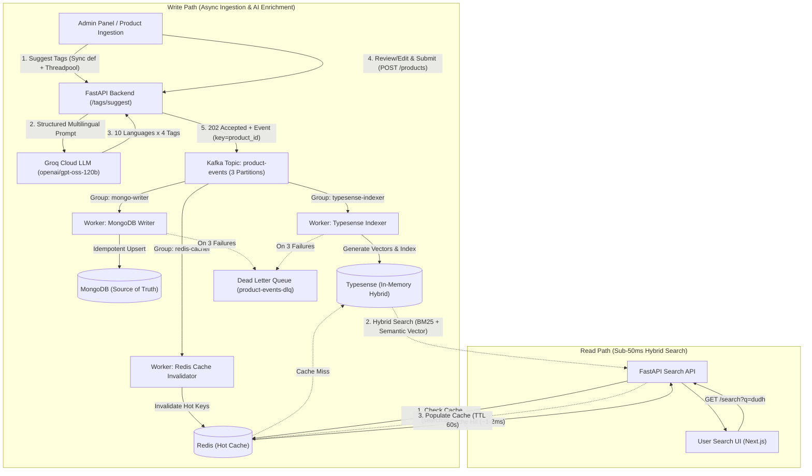

# ⚡ Blinkit-Style Multilingual Search at Scale

> **Sub-50ms hybrid search engine across millions of e-commerce products** using **FastAPI**, **Apache Kafka (KRaft)**, **Typesense (Hybrid Vector + Keyword)**, **MongoDB**, **Redis (Hot Cache)**, and **Groq Cloud LLM**.

[](https://www.python.org/)
[](https://fastapi.tiangolo.com/)
[-231F20.svg?logo=apachekafka&logoColor=white)](https://kafka.apache.org/)
[-E91E63.svg?logo=typesense&logoColor=white)](https://typesense.org/)
[](https://www.mongodb.com/)
[-DC382D.svg?logo=redis&logoColor=white)](https://redis.io/)
[](https://groq.com/)
[](LICENSE)

---

## 📌 Table of Contents
- [The Problem & Engineering Challenge](#-the-problem--engineering-challenge)
- [System Architecture (CQRS Pattern)](#-system-architecture-cqrs-pattern)
  - [Write Path (Async Ingestion & AI Enrichment)](#1-write-path-async-ingestion--load-leveling)
  - [Read Path (Sub-50ms Hybrid Search)](#2-read-path-sub-50ms-hybrid-search)
- [Key Architectural Decisions & Trade-Offs](#-key-architectural-decisions--trade-offs)
  - [Kafka-First Load Leveling](#1-kafka-first-write-path-load-leveling)
  - [Typesense Hybrid Search (BM25 + Semantic Vectors)](#2-typesense-hybrid-search)
  - [Groq Cloud LLM for Multilingual Tagging](#3-groq-cloud-llm--multilingual-tag-generation)
  - [Worker Reliability, Idempotency & DLQ](#4-worker-reliability-idempotency--dlq)
  - [Multi-Tier Caching with Redis](#5-multi-tier-caching-with-redis)
- [LLM Model Evaluation & Benchmarking](#-llm-model-evaluation--benchmarking)
- [Tech Stack & Port Mapping](#-tech-stack--port-mapping)
- [Project Directory Structure](#-project-directory-structure)
- [Getting Started & Setup Guide](#-getting-started--setup-guide)
  - [Prerequisites](#prerequisites)
  - [1. Infrastructure Setup (Docker Compose)](#1-infrastructure-setup-docker-compose)
  - [2. Backend Setup](#2-backend-setup)
  - [3. Running & Verifying the API](#3-running--verifying-the-api)
- [Development Roadmap](#-development-roadmap)
- [Deep Dive Documentation](#-deep-dive-documentation)

---

## 🎯 The Problem & Engineering Challenge

In quick-commerce platforms like **Blinkit**, **Zepto**, or **Instamart**, users search across diverse languages, regional dialects, and phonetic scripts:
- A user searching for milk might type:
  - **English:** `milk`, `toned milk`
  - **Roman Urdu / Hindi:** `doodh`, `dudh`
  - **Urdu:** `دودھ`
  - **Hindi (Devanagari):** `दूध`
  - **Regional Scripts:** Punjabi (`دُدھ`), Sindhi (`کير`), Pashto (`شیدې`), Italian (`latte`), Spanish (`leche`), German (`milch`)

### Core Challenges at Scale:
1. **Catalog Scale:** Searching through 1,000,000+ products with instant response times (< 50ms).
2. **Linguistic Variance & Typo Tolerance:** Exact keyword search (BM25) fails when the user types phonetic synonyms (`dudh` vs `doodh` vs `milk`). Pure vector search can be slow and miss exact brand names (`Amul Taaza`).
3. **Write Spikes & Peak Traffic:** Direct database writes during catalog updates or 1M+ bulk seeding choke transactional databases.
4. **LLM Cost & Rate Limits:** Cloud LLMs are powerful for tag generation but rate-limited (e.g., 8,000 tokens/min free tier). Calling LLMs synchronously during bulk ingestion would take days and crash the ingestion pipeline.

---

## 🏗 System Architecture (CQRS Pattern)

We decouple the **Write Path** (asynchronous, event-driven, fault-tolerant) from the **Read Path** (sub-millisecond, cache-heavy, in-memory search):



### 1. Write Path: Async Ingestion & Load Leveling
1. **Admin Product Creation:** Admin enters product name (`Amul Taaza Toned Milk 1L`).
2. **AI Multilingual Enrichment:** Groq LLM generates 40 localized tags across 10 languages (English, Roman Urdu, Urdu, Hindi, Punjabi, Sindhi, Pashto, Italian, Spanish, German) in strict JSON format.
3. **Sanitization:** Backend strips size attributes (`1L`, `500g`), removes duplicate synonyms, and blocks prohibited brand cross-pollination.
4. **Immediate Acceptance:** Backend validates payload, publishes a `product.created` event to Kafka with `acks=all`, and returns `202 Accepted` to the client.
5. **Decoupled Processing:** Independent consumer groups consume events at their own pace:
   - **`mongo-writer`**: Upserts full product record to MongoDB (Source of Truth).
   - **`typesense-indexer`**: Indexes tags and generates multilingual vector embeddings.
   - **`redis-cacher`**: Invalidates stale cache keys (`product:{id}`).

### 2. Read Path: Sub-50ms Hybrid Search
1. **Cache Look-aside:** Search query (`q=dudh`) checks Redis (`search:dudh:{filters}`).
2. **Cache Hit:** If found, response returns in **~1–2 ms**.
3. **Cache Miss & Hybrid Execution:** Query runs on Typesense combining:
   - **BM25 Keyword Matching:** Matches exact product names and brand keywords.
   - **Multilingual Vector Search:** Maps semantic meaning (`dudh` matches `milk` & `doodh`).
4. **Cache Warming:** Query results are stored in Redis with a short TTL (60 seconds).

---

## 💡 Key Architectural Decisions & Trade-Offs

### 1. Kafka-First Write Path (Load Leveling)
* **Decision:** Ingestion writes to Apache Kafka before touching any database.
* **Why not direct-to-database?** Under bulk imports (e.g., seeding 1,000,000 products) or flash-sales inventory updates, direct database writes cause connection starvation, lock contention, and cascading failures. Kafka acts as an elastic buffer, ensuring downstream workers write at steady state without choking.
* **Partitioning Strategy:** Partitioned by `product_id`. Events for the same product land on the same partition, guaranteeing chronological order (`created` -> `updated` -> `deleted`).

### 2. Typesense Hybrid Search
* **Decision:** Typesense in-memory search engine using hybrid ranking (BM25 + Dense Vectors) instead of Elasticsearch.
* **Trade-Off:** 
  - *Typesense:* Runs in RAM, extremely lightweight, zero-configuration hybrid search, built-in vector search support, sub-millisecond latencies.
  - *Elasticsearch:* Heavy JVM footprint, complex cluster management, expensive for quick-commerce workloads.

### 3. Groq Cloud LLM & Multilingual Tag Generation
* **Decision:** Groq Cloud LPU inference (`openai/gpt-oss-120b`) instead of local Ollama / Gemma 3.
* **Why:** Local 20B+ models require 32GB+ VRAM and take 15–30 seconds per inference on consumer hardware. Groq LPU delivers inferences in **~1.3–2.0 seconds**.
* **Rate-Limit Isolation:** LLM tagging is used **exclusively in the admin workflow** (interactive, low volume). Bulk seeding uses programmatic synthetic tag generation to avoid breaching cloud rate limits.
* **Non-Blocking Architecture:** Groq Python SDK is synchronous. Routes are defined with standard `def` (instead of `async def`) so FastAPI delegates blocking calls to its internal threadpool. The API's `/health` endpoint remains responsive at **~3 ms** even while LLM inferences run.

### 4. Worker Reliability, Idempotency & DLQ
* **At-Least-Once Delivery:** Workers commit Kafka offsets manually **only after** successfully writing to their respective store.
* **Idempotency:** Workers perform upserts keyed by `product_id`. If a worker crashes before committing, redelivered events produce identical results.
* **Resilience:** Automatic 3-stage exponential backoff retry. Unrecoverable poisonous events are routed to `product-events-dlq` to prevent consumer lag from stalling the entire pipeline.

### 5. Multi-Tier Caching with Redis
* **Cache Strategy:** Cache-Aside with LRU eviction (`maxmemory 256mb`, `allkeys-lru`).
* **Cache Invalidation:**
  - Query results: Short TTL (60s), absorbing repetitive search spikes.
  - Product details: Direct invalidation on Kafka update events (`product:{id}`).

---

## 📊 LLM Model Evaluation & Benchmarking

During Phase 2, we conducted empirical evaluations across candidate models using identical prompts and realistic product catalogs (Amul Milk, Tapal Danedar, Lay's Masala, Dettol Soap):

| Candidate Model | Avg Latency | Avg Tokens | Multilingual Quality & Hallucination Profile | Selected? |
|---|---|---|---|---|
| `qwen/qwen3.8-27b` | **~615 ms** | ~560 | High hallucination (`whole milk` on toned milk, `pyaz chips`). Strict rate limits (1000 output tokens/min). | ❌ Rejected |
| `openai/gpt-oss-20b` | ~780 ms | ~740 | Moderate accuracy, but generated overly literal translations (`मूल`, `اصل` for "Original") and fabricated attributes. | ❌ Rejected |
| **`openai/gpt-oss-120b`** | **~1300 ms** | **~880** | **Superior semantic precision** across regional scripts (`kali chai`, `namkeen chips`). Best linguistic diversity. | ✅ **Selected** |

> **Key Learning:** Newer or smaller models are faster, but multilingual semantic precision is critical for e-commerce. A human review step in the Admin UI ensures hallucinated tags never pollute the production search index.

---

## 🛠 Tech Stack & Port Mapping

| Service / Component | Technology | Role | Port |
|---|---|---|---|
| **Backend API** | FastAPI (Python 3.12) | REST API, validation, Kafka producer | `8000` |
| **Search Engine** | Typesense 31.0 (In-Memory) | Hybrid search (BM25 + Semantic Vector) | `8108` |
| **Message Broker** | Apache Kafka 4.3.2 (KRaft) | Event stream buffer, load leveling | `9092` (Host) / `29092` (Internal) |
| **Source of Truth** | MongoDB 8.0 | Primary document datastore | `27017` |
| **Cache Store** | Redis 8.2 (Alpine) | Hot query cache & LRU store | `6379` |
| **AI Tagging** | Groq Cloud (LPU Inference) | Multilingual search synonym generation | Cloud API |
| **Frontend** *(WIP)* | Next.js (App Router + TS) | Admin panel (`/admin`) & User Search UI (`/`) | `3000` |

---

## 📁 Project Directory Structure

```text
.
├── infra/
│   ├── docker-compose.yml       # Kafka (KRaft), MongoDB, Redis, Typesense, kafka-init
│   ├── .env.example             # Infrastructure credentials & API keys template
│   └── .env                     # Local infrastructure environment variables (git-ignored)
├── backend/
│   ├── pyproject.toml           # Pinned Python dependencies & hatchling packaging
│   ├── uv.lock                  # Deterministic dependency lockfile
│   ├── .env.example             # Backend settings template (GROQ_API_KEY, models)
│   ├── .env                     # Local backend secrets (git-ignored)
│   ├── scripts/
│   │   ├── test_groq.py         # Diagnostic script for Groq API latency & tokens
│   │   └── try_tags.py          # Benchmark test suite for multilingual tag generation
│   └── src/
│       ├── api/
│       │   ├── main.py          # FastAPI application entrypoint & health checks
│       │   ├── routes/
│       │   │   └── tags.py      # HTTP routes for AI tag suggestion (/tags/suggest)
│       │   └── services/
│       │       └── tagging.py   # Groq prompt design, strict JSON schema, sanitization
│       └── common/
│           ├── config.py        # Centralized Pydantic application settings
│           └── clients/
│               └── groq_client.py # Singleton client for Groq cloud API
├── architecture.md              # In-depth architectural trade-offs & system decisions
├── flow.md                      # Detailed data flow diagrams (Write path, Read path, DLQ)
├── phases.md                    # Step-by-step roadmap and progress tracking
├── guidelines.md                # Engineering standards, Context7 docs & best practices
└── overview.md                  # Project vision & scope notes
```

---

## 🚀 Getting Started & Setup Guide

### Prerequisites
- **Docker & Docker Compose** installed and running.
- **Python 3.12+** installed.
- **[uv](https://github.com/astral-sh/uv)** (Blazing fast Python package manager):
  ```bash
  # Windows (PowerShell)
  powershell -ExecutionPolicy ByPass -c "irm https://astral.sh/uv/install.ps1 | iex"
  # Linux/macOS
  curl -LsSf https://astral.sh/uv/install.sh | sh
  ```
- **Groq Cloud API Key** ([Get free API key here](https://console.groq.com/keys)).

---

### 1. Infrastructure Setup (Docker Compose)

Navigate to the `infra/` folder, create your `.env` file, and start the containers:

```bash
cd infra
cp .env.example .env
```

*Ensure your `infra/.env` contains your preferred credentials:*
```env
MONGO_USER=admin
MONGO_PASSWORD=secretpassword
TYPESENSE_API_KEY=xyz123typesensekey
```

Spin up the cluster:
```bash
docker compose up -d
```

Verify that all containers are healthy:
```bash
docker compose ps
```

*Expected output: `kafka`, `mongodb`, `redis`, and `typesense` running with `(healthy)` status; `kafka-init` exited with code 0.*

---

### 2. Backend Setup

Open a new terminal in the `backend/` directory:

```bash
cd backend
cp .env.example .env
```

Edit `backend/.env` with your Groq API credentials:
```env
GROQ_API_KEY=gsk_your_actual_groq_api_key_here
GROQ_MODEL=openai/gpt-oss-120b
GROQ_TIMEOUT_S=8
GROQ_MAX_RETRIES=1
```

Install pinned dependencies using `uv`:
```bash
uv sync
```

---

### 3. Running & Verifying the API

#### Test Tag Generation Script
Run the test script to see multilingual tags generated in real time:
```bash
uv run python scripts/try_tags.py
```

#### Start the FastAPI Server
```bash
uv run fastapi dev src/api/main.py
```

The server starts at `http://127.0.0.1:8000`.
- **Interactive Swagger Docs:** [http://127.0.0.1:8000/docs](http://127.0.0.1:8000/docs)
- **Health Check Endpoint:** [http://127.0.0.1:8000/health](http://127.0.0.1:8000/health)

#### Test Tag Suggestion via cURL / PowerShell
```bash
curl -X POST http://127.0.0.1:8000/tags/suggest \
  -H "Content-Type: application/json" \
  -d '{"name": "Amul Taaza Toned Milk 1L"}'
```

*Sample Response:*
```json
{
  "tags": [
    "fresh milk", "pasteurized milk", "daily dairy", "cow milk",
    "doodh", "dudh", "amul doodh", "taaza doodh",
    "دودھ", "امول دودھ", "تازہ دودھ", "ڈیری دودھ",
    "दूध", "ताज़ा दूध", "अमूल दूध", "गाय का दूध",
    "دُدھ", "تازہ دُدھ", "ڳئون جو کير", "تازہ کير",
    "شیدې", "latte fresco", "leche fresca", "frische milch"
  ],
  "by_language": {
    "english": ["fresh milk", "pasteurized milk", "daily dairy", "cow milk"],
    "roman_urdu": ["doodh", "dudh", "amul doodh", "taaza doodh"],
    "urdu": ["دودھ", "امول دودھ", "تازہ دودھ", "ڈیری دودھ"],
    "hindi": ["दूध", "ताज़ा दूध", "अमूल दूध", "गाय का दूध"],
    "punjabi": ["دُدھ", "تازہ دُدھ", "پنڈ دا دُدھ", "امول دُدھ"],
    "sindhi": ["کير", "تازہ کير", "ڳئون جو کير", "امول کير"],
    "pashto": ["شیدې", "تازہ شیدې", "د غوا شیدې", "امول شیدې"],
    "italian": ["latte fresco", "latte pastorizzato", "latte intero", "latticini"],
    "spanish": ["leche fresca", "leche pasteurizada", "lacteos", "leche de vaca"],
    "german": ["frische milch", "kuhmilch", "milchprodukt", "pasteurisierte milch"]
  },
  "source": "llm",
  "model": "openai/gpt-oss-120b",
  "latency_ms": 1380
}
```

---

## 📈 Development Roadmap

- [x] **Phase 0: System Architecture & Design**
  - [x] CQRS architecture & Kafka-first load leveling design
  - [x] Data models & multilingual taxonomy definition
- [x] **Phase 1: Infrastructure as Code**
  - [x] Multi-container Docker Compose (Kafka KRaft, MongoDB, Redis, Typesense)
  - [x] Automated topic initialization (`product-events`, `product-events-dlq`)
- [x] **Phase 2: AI Multilingual Tag Engine**
  - [x] 10-language structured prompt engineering with strict JSON output
  - [x] Empirical evaluation of Groq models (`gpt-oss-120b` chosen)
  - [x] Token reservation controls, regex sanitization & brand safety filters
- [ ] **Phase 3: Backend API (FastAPI)**
  - [x] `POST /tags/suggest` (Sync route + threadpool execution)
  - [ ] `POST /products` (Payload validation & idempotent Kafka publisher)
- [ ] **Phase 4: Kafka Event Consumer Workers**
  - [ ] `mongo-writer` (Bulk upsert & document persistence)
  - [ ] `typesense-indexer` (Multilingual vector embedding generation & indexing)
  - [ ] `redis-cacher` (Hot key eviction & cache sync)
  - [ ] Exponential backoff retries & Dead Letter Queue routing
- [ ] **Phase 5: Read Path & Search API**
  - [ ] `GET /search?q=` (Redis cache-aside with Typesense hybrid query)
  - [ ] Debounce handling & search analytics logging
- [ ] **Phase 6: Admin Dashboard (Next.js)**
  - [ ] Product creation wizard with live AI tag preview and tag editor
- [ ] **Phase 7: Consumer Search Frontend (Next.js)**
  - [ ] E-commerce search UI with real-time autocompletion and filters
- [ ] **Phase 8: Scale & Chaos Testing**
  - [ ] Seed script for 1,000,000 synthetic products
  - [ ] Consumer lag benchmarking & horizontal worker scaling (1 → 3 workers)
  - [ ] P50 / P95 / P99 latency stress testing

---

## 📚 Deep Dive Documentation

For detailed system design rationale, data schemas, and implementation notes:
- 📖 [Architecture Details (`architecture.md`)](architecture.md): Component responsibilities, trade-offs, and design justifications.
- 🔄 [System Data Flow (`flow.md`)](flow.md): In-depth walkthrough of write path, read path, failure recovery, and DLQ.
- 📋 [Engineering Phases (`phases.md`)](phases.md): Step-by-step development roadmap and progress checklist.
- 📐 [Code & System Guidelines (`guidelines.md`)](guidelines.md): Best practices for Kafka, connection pools, and Context7 doc lookups.

